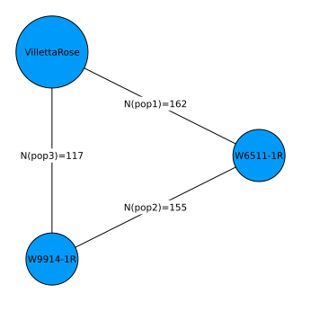
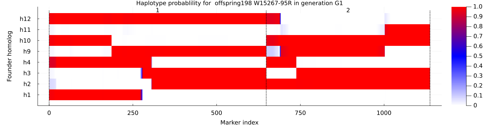
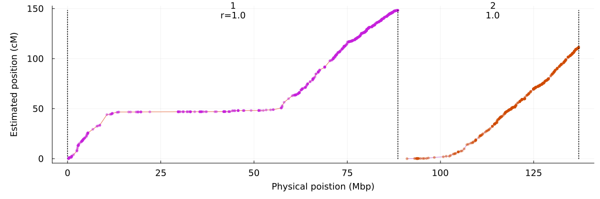

# Setup PolyOrigin

For parallel computation
~~~~{.julia}
using Distributed
nprocs() < 7 && addprocs(7-nprocs()) 
@info string("nworkers=", nworkers())
@everywhere using PolyOrigin
~~~~~~~~~~~~~

Set four worker processes on local machine. See the manual
of `addprocs` for launching worker processes via the specified cluster manager
or on remote machines via SSH. The processers consist of  1 main and 6 wokers: 
3 repated phasing runs for each of two chromsomes. 

The last line makes PolyOrigin avaiable on all processes.  

For non-parallel computation
~~~~{.julia}
using PolyOrigin
~~~~~~~~~~~~~

# Input files

Set working directory to the direcotry of this file.
~~~~{.julia}
cd(@__DIR__)
~~~~~~~~~~~~~

Set input files
~~~~{.julia}
genofile = "TableS2_dose.csv"
pedfile = "TableS3_ped.csv"
~~~~~~~~~~~~~

Check input files. In the pedfile, the parents of founders are set to 0.
~~~~{.julia}
using CSV, DataFrames
show(CSV.read(pedfile,DataFrame)[1:8,:],eltypes=false)
~~~~~~~~~~~~~

~~~~
8×5 DataFrame
 Row │ individual    population  mother    father        ploidy
─────┼──────────────────────────────────────────────────────────
   1 │ W6511-1R      0           0         0                  4
   2 │ VillettaRose  0           0         0                  4
   3 │ W9914-1R      0           0         0                  4
   4 │ W15268-1R     pop1        W6511-1R  VillettaRose       4
   5 │ W15268-4R     pop1        W6511-1R  VillettaRose       4
   6 │ W15268-5R     pop1        W6511-1R  VillettaRose       4
   7 │ W15268-6R     pop1        W6511-1R  VillettaRose       4
   8 │ W15268-7R     pop1        W6511-1R  VillettaRose       4
~~~~

In the genofile, columns 1-3 denote the marker map, and rest
columns for the dosages of parents and offspring (NA denotes missing).
~~~~{.julia}
show(CSV.read(genofile,DataFrame)[1:5,1:5],eltypes=false)
~~~~~~~~~~~~~

~~~~
5×5 DataFrame
 Row │ Marker               Chrom  Position  W6511-1R  VillettaRose
─────┼──────────────────────────────────────────────────────────────
   1 │ solcap_snp_c2_36608      1    251132         2             2
   2 │ solcap_snp_c2_36658      1    269400         2             2
   3 │ solcap_snp_c1_10930      1    309342         2             2
   4 │ PotVar0120130            1    353979         2             2
   5 │ PotVar0120070            1    433801         2             2
~~~~

plot pedigree for the 3x3 diallel cross.
~~~~{.julia}
polygeno = formpolygeno(genofile, pedfile; isphysmap=true,recomrate=1.25)
PolyOrigin.plotdesign(polygeno.polyped)
~~~~~~~~~~~~~

\ 

run polyOrigin
~~~~{.julia}
chrsubset = 1:2
outstem = "potato4x_F1_out"
~~~~~~~~~~~~~

~~~~{.julia}
@time phasedgeno, polyancestry, joinedancestry = polyorigin(genofile,pedfile;
    isphysmap=true,
    recomrate=1.25,
    chrsubset,
    isparallel=true,
    outstem
)
~~~~~~~~~~~~~

The keyargs `isphysmap`  and `recomrate` transform the input physical map (positions
in base pairs) into genetic map with speficied constant recombation rate. `isparallel`
specifies if computations are parallel among chromosomes, and `outstem`
specifies the stem of output files.

The returned polyancestry from `polyorigin` has been saved.
~~~~{.julia}
outfiles = filter(x->occursin(outstem,x), readdir())
~~~~~~~~~~~~~

~~~~
10-element Vector{String}:
 "potato4x_F1_out.log"
 "potato4x_F1_out_chrpairing.csv"
 "potato4x_F1_out_imputed.vcf.gz"
 "potato4x_F1_out_joinedancestry.csv.gz"
 "potato4x_F1_out_maprefined.vcf.gz"
 "potato4x_F1_out_nrecom.csv"
 "potato4x_F1_out_phased.vcf.gz"
 "potato4x_F1_out_plots"
 "potato4x_F1_out_plots.tar"
 "potato4x_F1_out_polyancestry.csv.gz"
~~~~

[Click to view log file](potato4x_F1_out.log)

# Visualize conditional probability

~~~~{.julia}
joinedancestry = PolyOrigin.readjoinedancestry(outstem*"_joinedancestry.csv.gz")
~~~~~~~~~~~~~

Visualize haplotype probabilities of single offspring
~~~~{.julia}
plotcondprob(joinedancestry,offspring=1)
~~~~~~~~~~~~~

\ 

# Evaluate estimated map

Compare estimated map with input physical map
~~~~{.julia}
plotmapcomp(joinedancestry.markermap,
    joinedancestry.markermap,
    isphysmap = [true, false],
    xlabel = "Physical poistion (Mbp)",
    ylabel = "Estimated position (cM)",
)
~~~~~~~~~~~~~

\ 

where r is kendall rank correlation for each chromsome.
